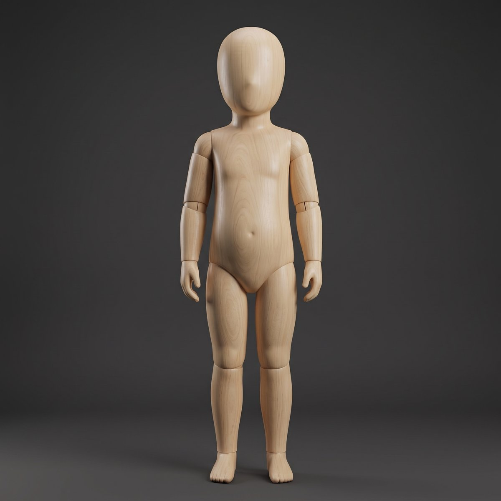
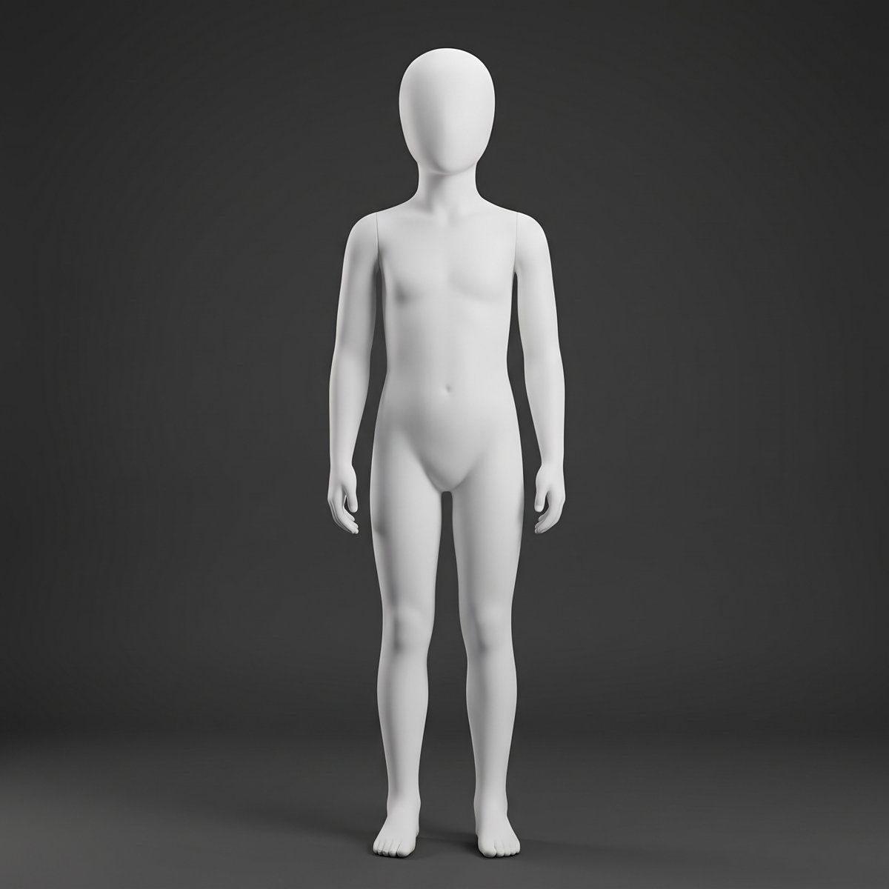
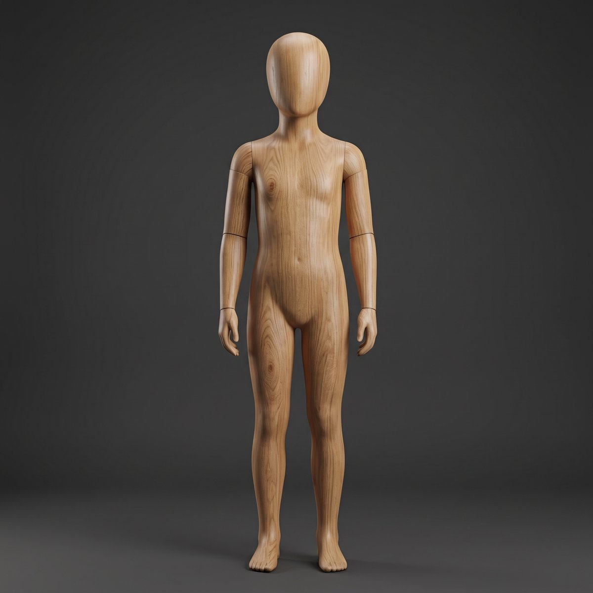
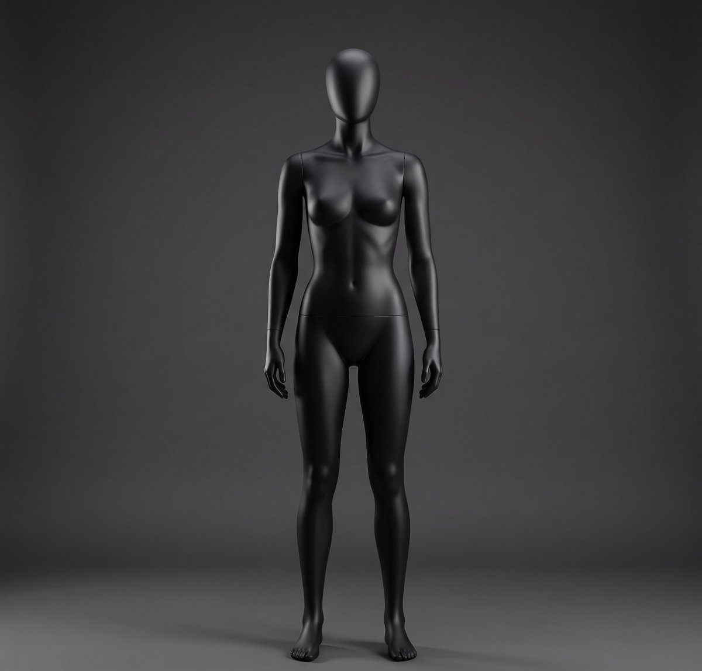
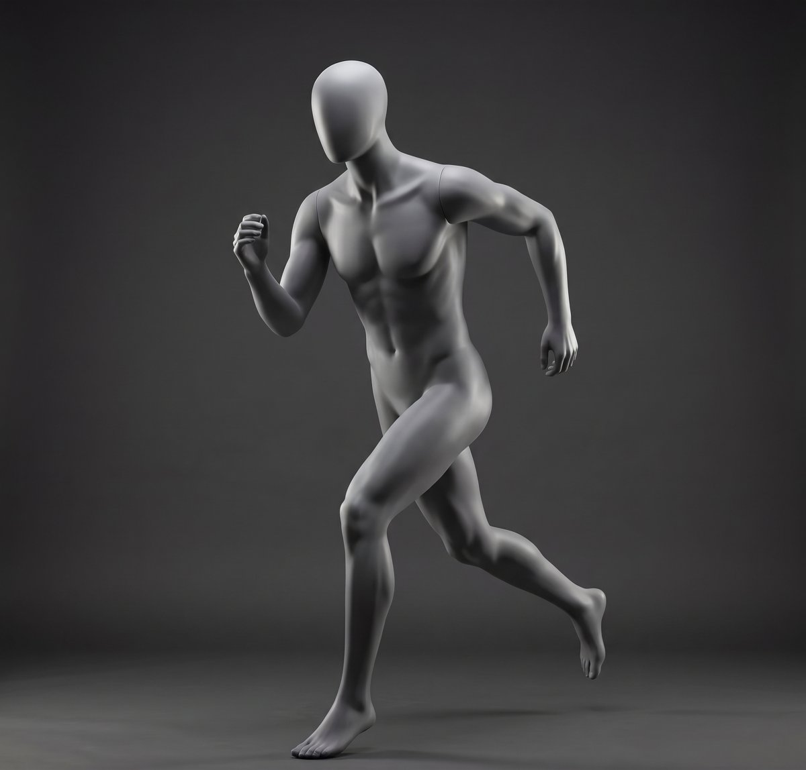

# Imagens de referência

Imagens que mostram o padrão esperado. Antes de gerar, veja as do seu contexto.

Nomeie os arquivos como `<contexto>-<assunto>-<n>.<ext>` (ex.: `ecommerce-jaleco-1.webp`, `geral-manequim-madeira-1.jpg`). Use `geral-` para referências que valem para todos os contextos.

| Arquivo | Contexto | O que mostra |
| --- | --- | --- |
|  [geral-manequim-recem-nascido-cinza.jpg](geral-manequim-recem-nascido-cinza.jpg) | Todos | Manequim de recém-nascido, cinza fosco, deitado. Único com traços do rosto esculpidos, bem suaves. |
|  [geral-manequim-infantil-madeira-clara.jpg](geral-manequim-infantil-madeira-clara.jpg) | Todos | Manequim infantil (criança pequena), madeira clara (marfim), rosto liso, de pé. |
|  [geral-manequim-infantil-branco.jpg](geral-manequim-infantil-branco.jpg) | Todos | Manequim infantil, branco fosco, rosto liso, de pé. |
|  [geral-manequim-adolescente-carvalho.jpg](geral-manequim-adolescente-carvalho.jpg) | Todos | Manequim adolescente, madeira carvalho, rosto liso, de pé. |
|  [geral-manequim-adulto-feminino-preto.jpg](geral-manequim-adulto-feminino-preto.jpg) | Todos | Manequim adulto feminino, preto fosco, rosto liso, de pé. |
|  [geral-manequim-adulto-masculino-cinza.jpg](geral-manequim-adulto-masculino-cinza.jpg) | Todos | Manequim adulto masculino, cinza fosco, rosto liso, em pose de corrida (pose dinâmica para roupa esportiva). |
